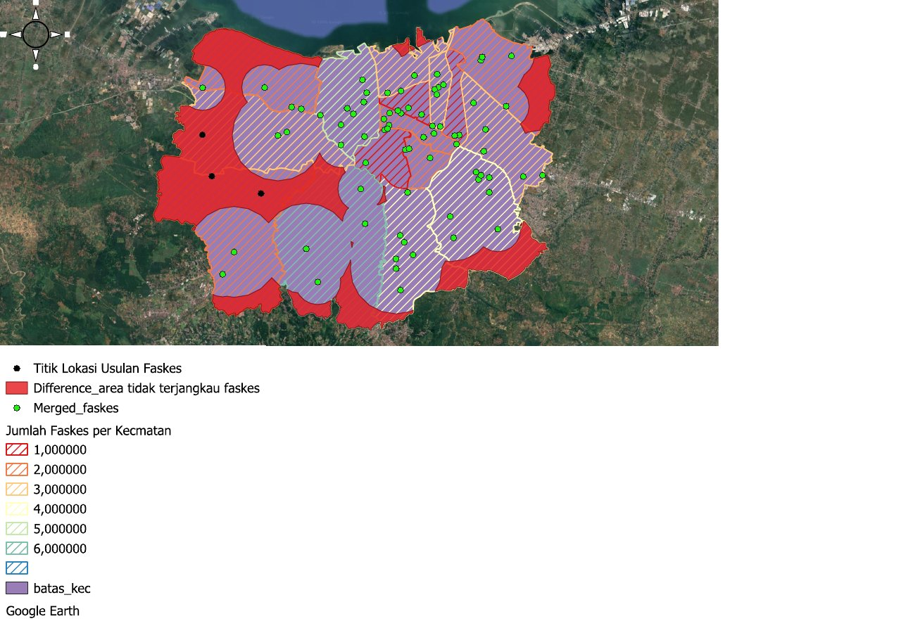

# Keterjangkauan Fasilitas Kesehatan Kota Semarang (QGIS)

Analisis buffer untuk menemukan wilayah Kota Semarang yang belum terjangkau rumah sakit dan puskesmas, lalu mengusulkan lokasi fasilitas kesehatan baru.

Tugas 1 bootcamp WebGIS Developer (GIS Fundamental).

## Pertanyaan

1. Bagaimana sebaran rumah sakit dan puskesmas per kecamatan?
2. Wilayah mana yang belum terjangkau berdasarkan jarak layanan?
3. Di mana lokasi yang layak untuk fasilitas kesehatan baru?

## Metode (QGIS)

1. Samakan CRS semua data ke EPSG:3857.
2. Clip titik rumah sakit dan puskesmas Jawa Tengah ke batas Kota Semarang.
3. Buffer jarak layanan: rumah sakit 3.000 m, puskesmas 1.500 m, lalu merge.
4. Join attributes by location untuk menghitung jumlah fasilitas per kecamatan.
5. Difference: batas kota dikurangi area layanan, sehingga tersisa area tidak terlayani.
6. Digitasi titik usulan fasilitas baru di area tidak terlayani, dekat jaringan jalan.

## Data

| Data | Sumber |
|---|---|
| Batas kota dan kecamatan | Geodatabase bootcamp |
| Rumah sakit Jawa Tengah 2025, puskesmas | Geoportal Provinsi Jawa Tengah |
| Jaringan jalan | OpenStreetMap (Overpass Turbo) |

## Isi repo

| File | Isi |
|---|---|
| `Peta Jumlah Fasilitas Kesehatan ... _final bgt.qgz` | Proyek QGIS final |
| `Merged Faskes_kota smg.json` | Titik faskes hasil clip dan merge |
| `Jumlah Faskes Per Kecamatan.json` | Jumlah faskes per kecamatan |
| `Area yg tidak terlayani RS dan Puskesmas.json` | Hasil difference |
| `Titik Lokasi.json` | Titik usulan fasilitas baru |
| `Peta Final.pdf` | Layout peta |
| `Laporan Analisa Singkat_Task 1_GIS Fundamental.pdf` | Laporan singkat |

## Tools

QGIS · OpenStreetMap · GeoJSON

## Penulis

**Arsya Dika** · [GitHub](https://github.com/ArsyaDika)
